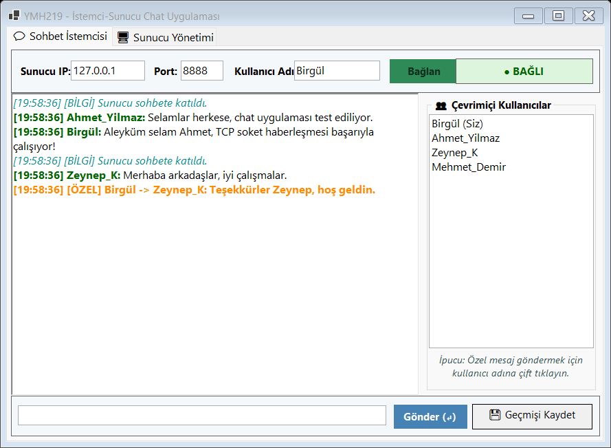
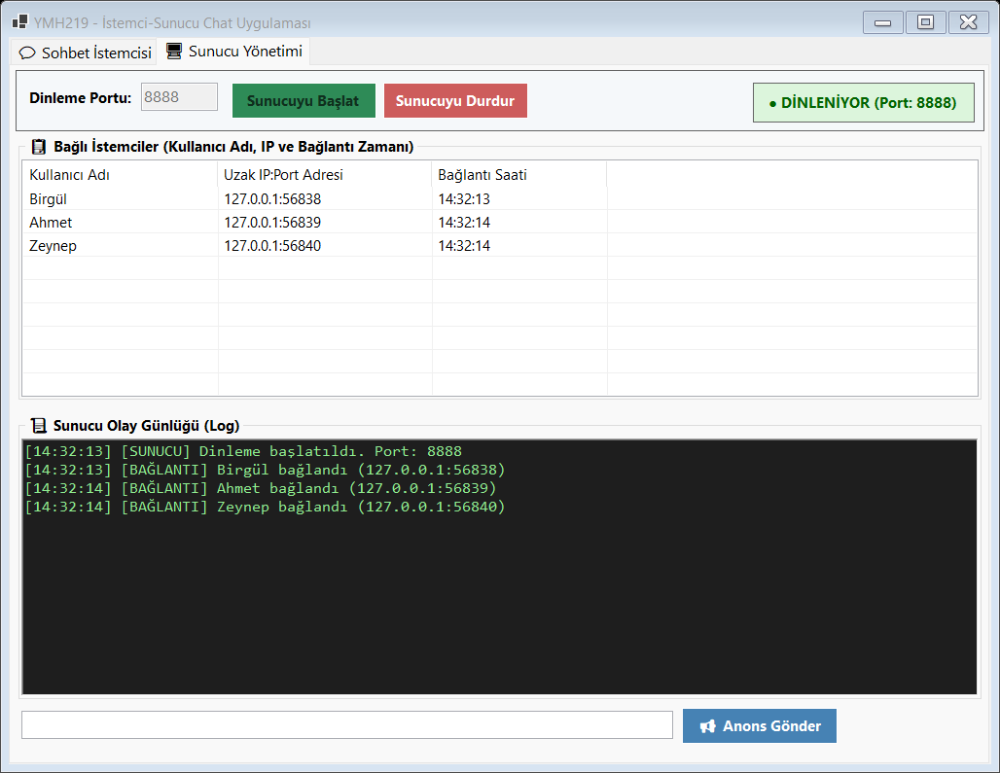

# YMH219 - İstemci-Sunucu Chat Uygulaması

Bu proje, Fırat Üniversitesi **Nesne Tabanlı Programlama (YMH 219)** dersi kapsamında Windows Forms ortamında C# dili kullanılarak geliştirilmiş çok kullanıcılı bir TCP/IP istemci-sunucu (Client-Server) sohbet uygulamasıdır.

---

## 📌 Projenin Amacı ve Kısa Açıklama

Projenin temel amacı; ağ programlama kavramlarını (TCP/IP, soket haberleşmesi), `TcpListener` ve `TcpClient` sınıflarını, asenkron işlemleri (`async`/`await`) ve arayüzün eş zamanlı thread güvenli güncellenmesini nesne yönelimli mimariyle uygulamaktır. Uygulama aynı form üzerinde hem sunucu (Server) yönetimini hem de istemci (Client) sohbet modunu barındırır.

---

## 🛠️ Kullanılan Teknolojiler

- **Programlama Dili:** C# (.NET 10.0 / Windows Desktop SDK)
- **Ağ İletişimi:** `System.Net.Sockets` (TcpListener, TcpClient, NetworkStream, StreamReader/StreamWriter)
- **Veri Paketleme:** `System.Text.Json` (JSON serileştirme ile güvenilir paket iletimi)
- **Eşzamanlılık:** `async`/`await`, `CancellationToken`, `SemaphoreSlim`
- **Arayüz Çerçevesi:** Windows Forms (WinForms, TabControl, RichTextBox, ListView)
- **Harici NuGet paketi:** Yok
- **Sürüm Kontrolü:** Git & GitHub

---

## 🚀 Kurulum ve Çalıştırma Adımları

### Gereksinimler
- Windows 10 veya Windows 11
- [.NET 10 SDK](https://dotnet.microsoft.com/download/dotnet/10.0)
- Visual Studio 2026 (".NET masaüstü geliştirme" iş yükü) **veya** komut satırı için yalnızca .NET 10 SDK

> Proje `net10.0-windows` hedeflediği için Visual Studio 2022 ile açılamaz.

### Çalıştırma
1. Projeyi bilgisayarınıza klonlayın:
   ```bash
   git clone https://github.com/BirgulGokturk/YMH219-ChatApp.git
   cd YMH219-ChatApp
   ```
2. Projeyi derleyin ve çalıştırın:
   ```bash
   dotnet build
   dotnet run
   ```
   *Veya `YMH219_ChatApp.sln` dosyasını Visual Studio ile açarak F5 tuşu ile başlatabilirsiniz.*

### Test Senaryosu (Aynı Bilgisayarda Test Etme)
1. Uygulamayı başlatın ve **"🖥️ Sunucu Yönetimi"** sekmesine geçerek **"Sunucuyu Başlat"** butonuna tıklayın (Varsayılan Port: `8888`).
2. **"💬 Sohbet İstemcisi"** sekmesine geçin, kullanıcı adınızı yazın ve **"Bağlan"** butonuna tıklayın.
3. İkinci bir istemci için uygulamayı tekrar çalıştırın (`.exe` dosyası veya yeni bir terminalde `dotnet run`). İkinci pencerede sunucuyu **başlatmayın**; yalnızca istemci sekmesinden farklı bir kullanıcı adıyla (örn: `Ahmet`) bağlanın. Aynı portta ikinci bir sunucu başlatılmaya çalışılırsa uygulama "port kullanımda" uyarısı verir.
4. Farklı bilgisayarlardan bağlanmak için istemcide **Sunucu IP** alanına sunucunun yerel ağ IP adresini (örn: `192.168.1.20`) yazın. Windows Güvenlik Duvarı ilk çalıştırmada izin isteyebilir.

---

## ⚙️ Uygulamanın Temel Özellikleri

### 1. Asgari Gereksinimler
- **TCP/IP Ağ İletişimi:** `TcpListener` ile yerel port dinleme ve `TcpClient` ile asenkron soket bağlantısı.
- **Kullanıcı Adı ile Bağlantı:** İstemciler kullanıcı adı belirterek odaya girer. Kullanıcı adı boş olamaz, en fazla 20 karakter olabilir, virgül içeremez ve "Sunucu" ile başlayamaz (bu kurallar `UsernameRules` sınıfında toplanmıştır; hem form hem sunucu aynı kuralları kullanır). Aynı ad zaten bağlıysa sunucu adın sonuna bir sayı ekler.
- **Zaman Bilgili Mesajlaşma:** Alınan ve gönderilen tüm mesajlar saat/dakika/saniye zaman damgasıyla gösterilir; katılma/ayrılma bildirimleri katılan kullanıcının adıyla gösterilir.
- **Bağlantı Kontrolü:** "Bağlan", "Mesaj Gönder" ve "Bağlantıyı Kes" fonksiyonları mevcuttur.
- **Hata Yönetimi:** Aşağıdaki durumlar uygulamayı kapatmadan kullanıcıya anlaşılır mesajlarla bildirilir:
  - Sunucu portu başka bir uygulama tarafından kullanılıyorsa ("port kullanımda"),
  - Bağlanılan adreste çalışan sunucu yoksa ("bağlantı reddedildi"),
  - Sunucuya 5 saniye içinde ulaşılamazsa ("zaman aşımı"),
  - Sohbet sırasında sunucu kapanırsa veya bağlantı koparsa,
  - Geçersiz IP, port veya kullanıcı adı girilirse.
- **Bağlı İstemcileri Listeleme:** Sunucu ekranında bağlı tüm istemcilerin kullanıcı adı, IP:Port adresi ve katılım zamanı anlık olarak listelenir.

### 2. İsteğe Bağlı / Ek Geliştirmeler (Bonus)
- 👥 **Çoklu İstemci ve Genel Yayın (Broadcast):** Birden fazla istemci aynı odaya katılarak eş zamanlı grup sohbeti gerçekleştirebilir. Aynı anda gelen mesajlar her istemciye `SemaphoreSlim` kilidiyle sırayla yazılır; böylece eşzamanlı yayında mesaj kaybolmaz.
- 🔒 **Özel Mesaj (Private Message):** Çevrimiçi kullanıcılar listesinden bir isme çift tıklayarak veya `@KullanıcıAdı mesaj` formatında yalnızca seçilen kişiye özel mesaj gönderilebilir.
- 💾 **Sohbet Geçmişini Kaydetme (.txt):** "Geçmişi Kaydet" butonu ile yapılan tüm yazışmalar tarih/saat damgalı olarak yerel bir metin dosyasına aktarılabilir.
- 📢 **Sunucu Genel Anonsu:** Sunucu yöneticisi bağlı tüm istemcilere genel sistem anonsu gönderebilir.
- 🛡️ **Sunucu Tarafı Doğrulama:** İstemciler yalnızca sohbet ve özel mesaj gönderebilir; katılma, ayrılma, kullanıcı listesi ve sistem mesajlarını yalnızca sunucu üretir. Böylece bir istemci sahte kullanıcı listesi veya sistem duyurusu yayınlayamaz.
- 🎨 **Renkli Mesajlaşma:** Kullanıcının kendi mesajları, diğer kullanıcıların mesajları, katılım/ayrılma bildirimleri ve özel mesajlar farklı renk ve stillerde görüntülenir.

---

## 📸 Ekran Görüntüleri

| Sohbet İstemcisi Ekranı | Sunucu Yönetimi ve Bağlı İstemciler |
|:---:|:---:|
|  |  |

---

## 🏗️ Nesne Tabanlı Mimari

```
YMH219-ChatApp/
├── Models/
│   ├── MessageType.cs        # Mesaj türleri (Chat, Private, Join, Leave, UserList, System)
│   ├── ChatMessage.cs        # Ağ üzerinden aktarılan JSON veri paketi modeli
│   ├── ClientInfo.cs         # Sunucuda listelenen istemci bilgileri modeli
│   └── UsernameRules.cs      # Kullanıcı adı kuralları (istemci ve sunucu ortak kullanır)
├── Network/
│   ├── ChatServer.cs         # Çoklu istemci yönetimi, dinleme döngüsü ve broadcast sunucusu
│   └── ChatClient.cs         # Asenkron TCP bağlantısı, zaman aşımı ve kopma bildirimi
├── Services/
│   └── ChatHistoryManager.cs # Mesaj geçmişi yönetimi ve .txt dışa aktarma servisi
├── screenshots/
│   ├── ekran1.png
│   └── ekran2.png
├── Form1.cs                  # Form olayları, thread senkronizasyonu ve arayüz mantığı
├── Form1.Designer.cs         # İstemci ve Sunucu sekmeli WinForms tasarımı
├── Program.cs                # Giriş noktası
├── YMH219_ChatApp.csproj
└── YMH219_ChatApp.sln
```

---

## 📝 Bilinen Sınırlamalar / Geliştirme Notları

- İletişim yerel ağ (LAN) veya yerel bilgisayar (localhost - 127.0.0.1) üzerinde çalışmak üzere tasarlanmıştır; mesajlar şifrelenmeden (düz JSON) gönderilir.
- Aynı kullanıcı adıyla ikinci kez bağlanıldığında sunucu adı değiştirir (örn: `Ali_42`) ancak yeni adı istemciye bildirmez; bu istemcide kendi mesajları "başkasının mesajı" rengiyle görünebilir.
- Gelecek versiyonlarda uçtan uca şifreleme (AES) ve dosya/resim transferi özellikleri eklenebilir.

---

## 👤 Öğrenci Bilgileri

- **Adı Soyadı:** Birgül Göktürk
- **Öğrenci Numarası:** 250541094
- **Ders:** Nesne Tabanlı Programlama (YMH 219)
- **Dönem:** 2026-2027 Güz
